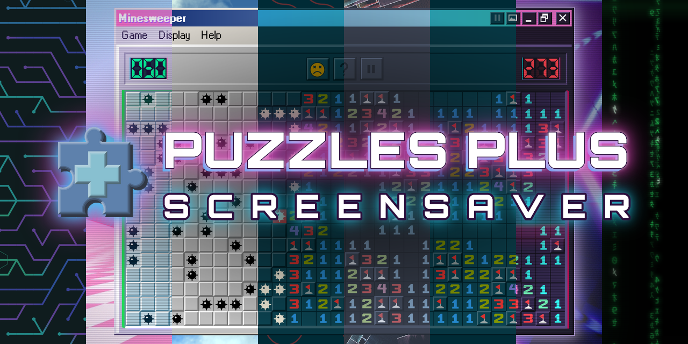
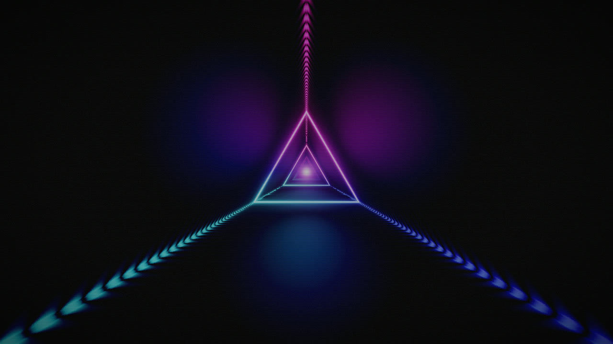
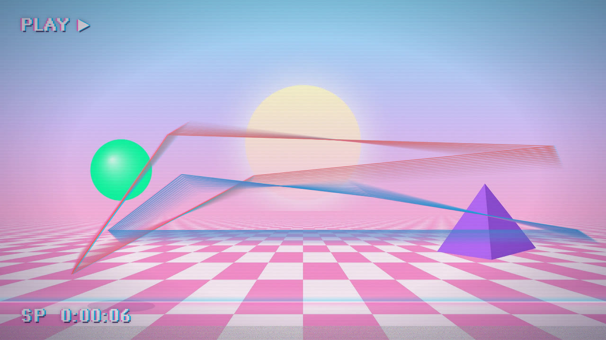
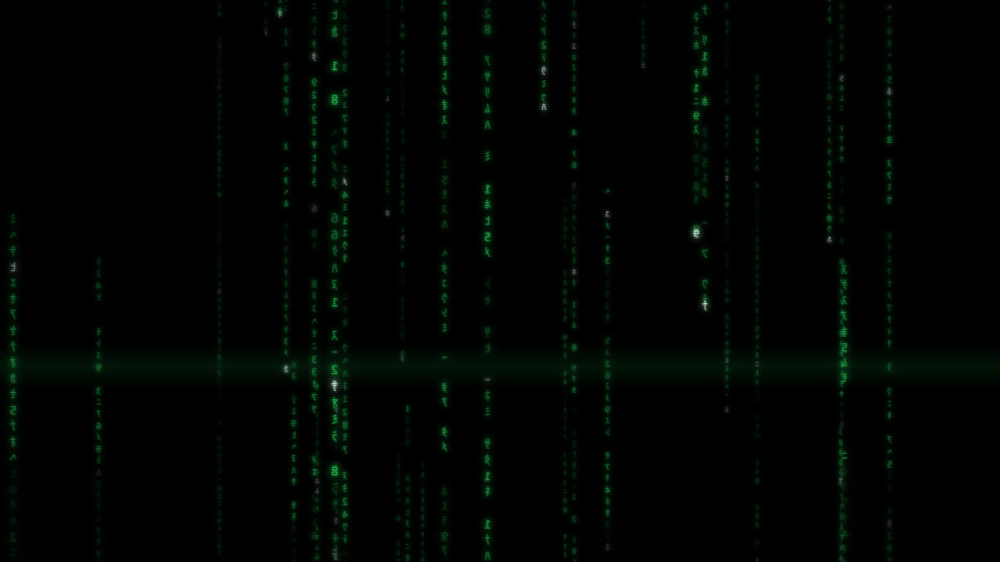
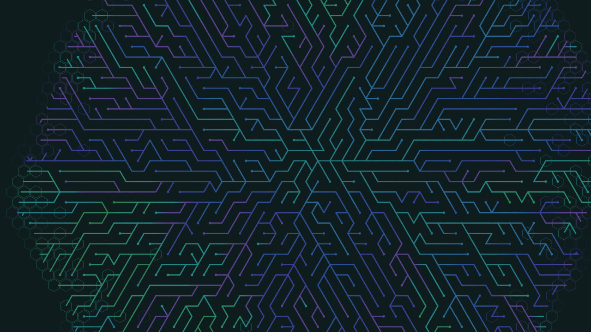
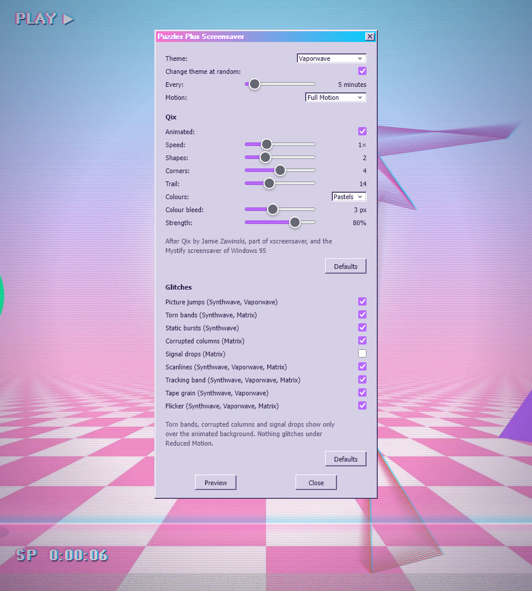

<p align="center"></p>

# Puzzles Plus Screensaver

The animated themes of [Puzzles Plus](https://github.com/fexofenadine/puzzlesplus) as a Windows screensaver: the xscreensaver ports and shaders behind its nine themes, fullscreen, with every effect the website has, from Synthwave's VHS tears and bursts of static to Vaporwave's worn tape and Matrix's CRT and garbled columns.

**[Download the latest release](https://github.com/fexofenadine/puzzlesplus-screensaver/releases/latest)** (`PuzzlesPlus.scr`)

| Synthwave: Neon Triangulator under VHS scanlines          | Vaporwave: Qix over a worn tape                    |
| --------------------------------------------------------- | -------------------------------------------------- |
|               |        |
| **Matrix: code rain behind a CRT, its band rolling down** | **Terafox Hex Trail**                              |
|                     |  |

**The settings, over the screensaver itself: theme or a random one, the background's options and every glitch**



## Installing

1. Download `PuzzlesPlus.scr`.
2. Right-click it and choose **Install**, or copy it to `C:\Windows\System32` and pick **Puzzles Plus** in Windows' Screen Saver Settings.
3. Windows may warn that the file is from an unknown publisher the first time, since it is not signed.

It needs Windows 10 or 11 with the WebView2 runtime, which both ship with.

## Settings

**Settings...** in Windows' Screen Saver Settings opens a window over the screensaver itself, so each change shows as you make it:

- **Theme**: Classic, Synthwave, Matrix, Nord, Solarized Truchet, Solarized Phosphor, Vaporwave, Terafox Hex Trail or Terafox Coral, or **Change theme at random** every so many minutes (5 by default).
- **Motion**: full, reduced (the glitches and rolling bands stop) or as the system says.
- The theme's background, with every option of its xscreensaver original (speed, density, colours, resolution and the rest), and **Defaults**.
- **Glitches**: each screen effect on or off, the ones that come now and then and the scanlines, band, grain and flicker that stay.
- **Preview** runs the screensaver fullscreen.

A key, a click, a turned wheel or a mouse moved more than a nudge ends it. It shows on the main screen; others are left as they are.

## Building

The screensaver is the website's code built in its own mode (`vite --mode screensaver`, pages in `screensaver/` and `src/screensaver/`) inside a small [Tauri](https://tauri.app) program (`src-tauri/`) that answers Windows' screensaver switches: `/s` fullscreen, `/c` settings and `/p` the preview drawn in the settings' little monitor.

It needs Node, Rust (`rustup`, the MSVC toolchain) and Visual Studio's C++ build tools.

```sh
npx yarn@1 install           #dependencies
npx vite --mode screensaver  #the pages in a browser, at /screensaver/ and /screensaver/settings.html
npm run build:screensaver    #release/PuzzlesPlus.scr
py -3 -I scripts/shots.py    #the pictures above, with the vite server running on port 5175
```

Fixes to the backgrounds and effects are made in [fexofenadine/puzzlesplus](https://github.com/fexofenadine/puzzlesplus) and merged in from there (`git merge upstream/master`).

## Credits

The backgrounds, themes and their credits are those of [Puzzles Plus](https://github.com/fexofenadine/puzzlesplus#credits): ports of xscreensaver hacks by Jamie Zawinski, J. Tarbell, Mike Kershaw, Adrian Likins and Frederick Roeber, shaders by mrange and drift, and photos from Unsplash. Released under the MIT licence.
